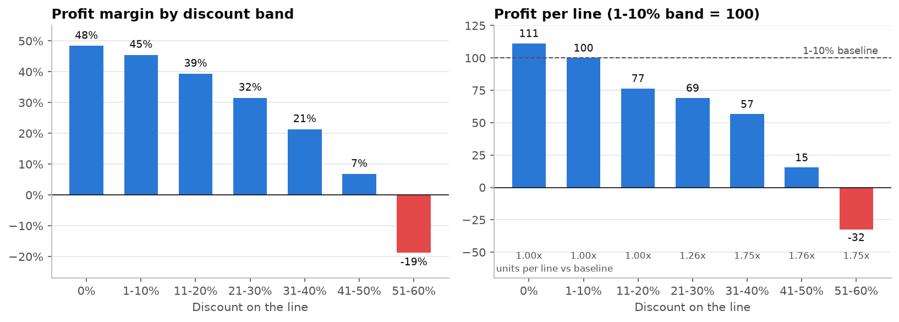
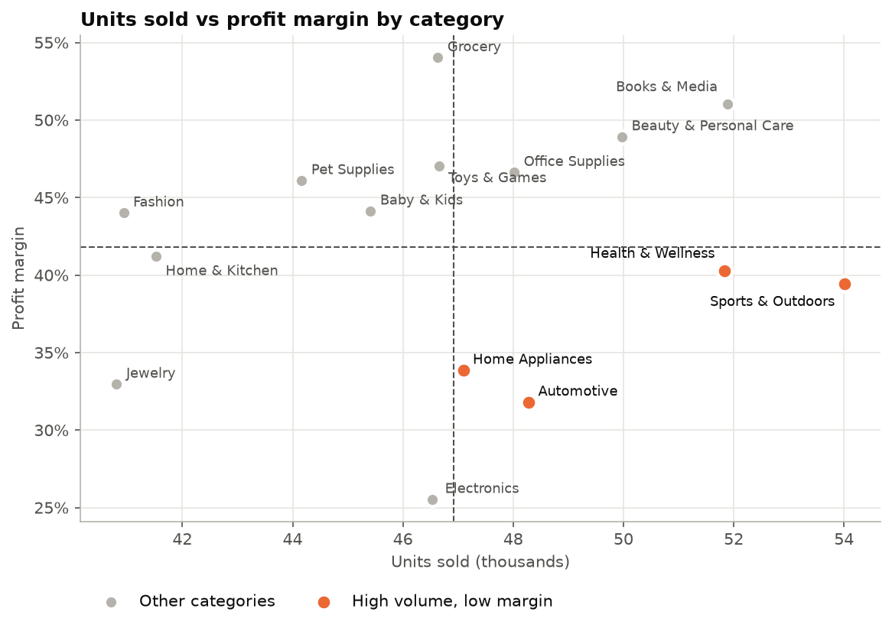
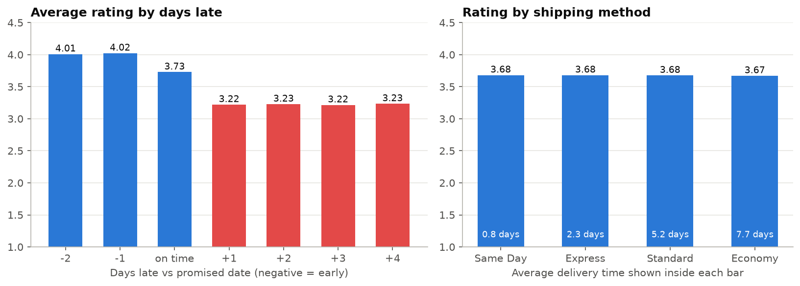

# Do Discounts and Delivery Help or Hurt an Online Retailer?

An end-to-end data analytics project: **Python data quality checks → SQL (SQLite) → pandas → Excel → Tableau**,
answering three business questions about discounting and delivery for an online retailer.

> **Note:** the dataset is **simulated** (synthetic e-commerce data: 138,116 orders, 397,569 order lines, 2021-2025).
> The findings show the analytical method; they don't describe a real company.

**Read the one-page summary:** [docs/write_up.md](docs/write_up.md)  ·  **Tableau dashboard:** *add your Tableau Public link here*

---

## The business problem

An online retailer wants to know whether its **discounts** and **delivery performance** help or hurt the business.

| # | Question | Short answer |
|---|---|---|
| 1 | At what discount level does a sale stop making money, and does extra volume make up for it? | Lines lose money once the discount is bigger than the product's margin (from **about 30%**); the average sale goes negative **above 50%**. Volume does **not** make up for it. |
| 2 | Which product categories sell a lot but earn little? | **Sports & Outdoors, Health & Wellness, Automotive, Home Appliances**, because of cost structure, not discounting. |
| 3 | Does slower delivery lead to lower customer ratings? | **No, late delivery does.** Late orders get 3.22★ vs 3.73★ on time; Economy and Same Day rate the same. |

## Key charts





---

## Project structure

```
ecommerce-discount-delivery-analysis/
├── run_pipeline.py                  # runs every stage in order
├── requirements.txt
├── data/
│   ├── raw/                         # the 4 source CSVs (not committed - see data/raw/README.md)
│   └── ecommerce.db                 # SQLite database (built by stage 2, not committed)
├── scripts/
│   ├── 01_data_quality_check.py     # Stage 1
│   ├── 02_build_database.py         # Stage 2
│   ├── 04_build_excel_summary.py    # Stage 4
│   └── 05_export_tableau.py         # Stage 5
├── sql/
│   ├── 01_schema.sql                # tables, keys, indexes, reusable view
│   └── 02_analysis_queries.sql      # 13 commented queries (joins, CTEs, window functions)
├── notebooks/
│   └── analysis.ipynb               # Stage 3 - pandas analysis with explanations
├── reports/
│   └── data_quality_report.md       # output of stage 1
├── outputs/
│   ├── sql_results/                 # one CSV per SQL query
│   └── ecommerce_summary.xlsx       # Stage 4 - Excel summary with chart
├── tableau/
│   ├── order_lines_clean.csv        # Stage 5 - cleaned exports for Tableau
│   └── orders_delivery_clean.csv
├── images/                          # charts saved by the notebook
└── docs/
    ├── write_up.md                  # Stage 6 - one-page write-up
    └── tableau_dashboard_guide.md   # click-by-click Tableau Public guide
```

## How to run it

1. Put the four raw CSVs in `data/raw/` (see [data/raw/README.md](data/raw/README.md)).
2. Install the libraries and run the pipeline:

```bash
pip install -r requirements.txt
```

```bash
python run_pipeline.py
```

This takes about a minute. Then follow [docs/tableau_dashboard_guide.md](docs/tableau_dashboard_guide.md) to build
the dashboard in Tableau Public.

---

## The data

Four linked tables:

```
customer_master (25,000) 1──< orders (138,116) 1──< order_items (397,569) >──1 product_catalog (1,175)
```

* **orders**: one row per order: status, shipping method, delivery days vs promised days, customer rating
* **order_items**: one row per product in an order: quantity, price, `discount_percentage` (a **0-1 fraction**), cost
* **product_catalog**: category, list price, unit cost
* **customer_master**: customer details

Sales and marketing channels were left out: they showed no real differences between channels.

---

## Stage by stage: what each step does and why

### Stage 1: Data quality check (`scripts/01_data_quality_check.py`)
**What:** 39 automated checks covering duplicates, missing values, whether the tables join up, value ranges, and
whether the money columns add up. Each check is marked PASS / INFO / WARN, with a decision for every WARN.
Output: [reports/data_quality_report.md](reports/data_quality_report.md).

**Why:** results can't be better than the data behind them. Checking first means every later number rests on decisions
you can explain. Three issues changed the analysis:

| Issue found | Decision |
|---|---|
| The supplied `profit` column = net sales − cost − shipping, and net sales **includes sales tax**, so tax is counted as profit | Recalculate **profit before tax = gross sales − discount − product cost** |
| 8.1% of order headers don't match the sum of their line items | Use **order_items** for every money figure |
| Discount is 0% on 93% of cancelled/returned lines (wiped by the simulator) | Analyse **Completed orders only** |

Expected blanks were also confirmed: delivery and rating are only blank for orders that never completed, and
`return_status` is only filled for returned orders.

### Stage 2: SQLite database and SQL (`sql/`, `scripts/02_build_database.py`)
**What:** builds a SQLite database with **primary keys** (each row is unique), **foreign keys** (an order item must
belong to a real order and product), **indexes** (fast joins), and a **view** (`v_completed_lines`) that joins the
tables and applies the cleaning rules once. Then it runs 13 commented queries and saves each result to
`outputs/sql_results/`.

**Why:** SQL is how most companies store and query data. The queries show **INNER/LEFT JOINs**, **CASE** banding,
**CTEs** (`WITH ...`) and **window functions** (`RANK() OVER`, `AVG() OVER ()`). The view means the business logic
(what counts as profit, which orders count) lives in one place, not copied into every query.

### Stage 3: pandas notebook (`notebooks/analysis.ipynb`)
**What:** repeats the analysis in Python, with a plain-English explanation before every section, adds the charts, and
ends by **cross-checking pandas against SQL** (they match exactly).

**Why:** pandas is better than SQL for exploring and charting. Getting the same answer two independent ways is strong
evidence the logic is right.

Key analytical ideas worth explaining:
* **Margin = total profit ÷ total revenue** for a group, not an average of percentages (big sales count more).
* **Break-even rule:** a sale loses money exactly when *discount % > product margin %*. Tested on all 327,028 lines:
  no exceptions.
* **Volume test:** compare *units needed* to match a lightly discounted line's profit with *units actually sold*. At
  41-50% off, a line needs 11.5× the units but sells only 1.76×.
* **Natural experiment for delivery:** Economy shipping takes 10× longer than Same Day, but is late equally often.
  Equal ratings show that lateness, not speed, drives the score.

### Stage 4: Excel summary (`outputs/ecommerce_summary.xlsx`)
**What:** a four-sheet workbook (Summary with KPIs, findings and recommendations; Discount Bands with a native Excel
chart; Categories; Delivery), built by `scripts/04_build_excel_summary.py` from the SQL results.

**Why:** many business stakeholders work in Excel. Generating the workbook from code means it never drifts from the
analysis and can be refreshed in seconds.

### Stage 5: Tableau (`tableau/`, `docs/tableau_dashboard_guide.md`)
**What:** two tidy CSVs with the cleaning already applied, plus a click-by-click guide for a 3-chart dashboard (one
chart per question) in Tableau Public.

**Why:** an interactive dashboard is how findings get shared and explored. Doing the cleaning upstream keeps Tableau
simple and consistent with every other output.

### Stage 6: One-page write-up (`docs/write_up.md`)
Problem → method → three findings, each with a recommendation → limitations. The format a manager actually reads.

---

## Findings and recommendations

1. **Cap discounts.** Margin falls from 45.5% (1-10% off) to 6.8% (41-50%) and −18.8% (51-60%). Keep blanket promotions
   at 30% or less and never discount a product beyond its own margin.
2. **Fix cost in four categories.** Sports & Outdoors, Health & Wellness, Automotive and Home Appliances sell above
   average at below-average margins, with the same ~19% discount as everyone else. Review supplier costs and prices,
   and leave them out of deep promotions.
3. **Promise realistic delivery dates.** Late orders lose half a star; 26.5% are rated below 3 (vs 3.8% on time).
   Delays are spread evenly across warehouses (14-16%), so fix how dates are promised and track the on-time rate.

## Limitations
* **Simulated data:** patterns are cleaner than real life (e.g. ratings are flat across shipping methods).
* **Correlation, not causation:** there was no controlled experiment (A/B test).
* **Returns vs discounts can't be measured,** because discounts were wiped on returned orders.

## Tools
Python 3 (pandas, numpy, matplotlib, openpyxl) · SQLite · Jupyter · Excel · Tableau Public
